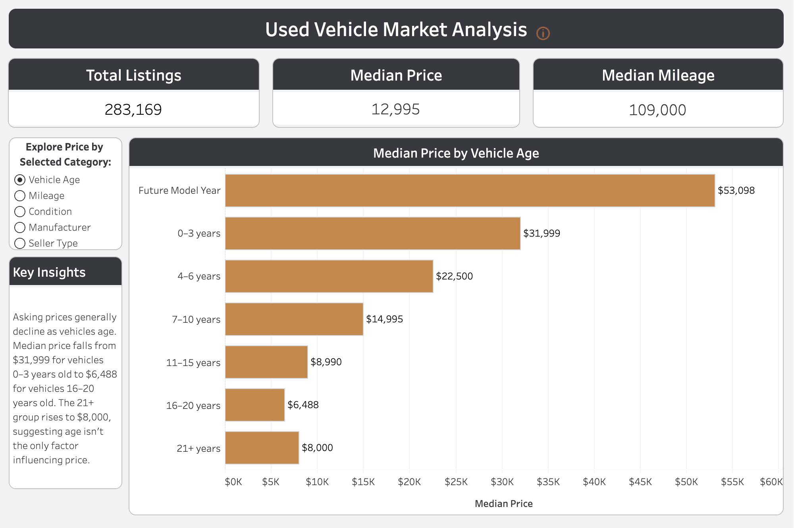

# Used Vehicle Market Analysis

## Project overview
This project analyzes Craigslist vehicle advertisements across multiple U.S. states to explore used-vehicle asking prices and listing characteristics. PostgreSQL was used to profile, clean, and analyze the data; Tableau Public was used to build an interactive dashboard.

The final primary analysis contains **283,169 listings**. Prices are seller asking prices, not verified sale prices.

## Dashboard Preview



[View the interactive dashboard on Tableau Public](https://public.tableau.com/app/profile/jake.rackwitz/viz/UsedCarMarketAnalysis_17952220222270/MarketOverview)

## Business questions
1. How does vehicle age relate to median asking price?
2. How does mileage relate to median asking price?
3. How do asking prices vary by reported condition?
4. How do asking prices vary by manufacturer?
5. How do dealer and owner listings compare?
6. How do asking prices vary across states?
7. What data-quality limitations should be considered when interpreting the results?

## Data source
**Craigslist Cars & Trucks**, by Austin Reese, sourced from Kaggle:
https://www.kaggle.com/datasets/austinreese/craigslist-carstrucks-data

The records are publicly available Craigslist vehicle advertisements. They are not completed transactions or verified sale prices.

## Tools
- PostgreSQL
- DBeaver
- Tableau Public
- CSV

## Repository structure
```text
used-vehicle-market-analysis/
├── README.md
├── images/
│   └── dashboard.png
└── sql/
    ├── 01_data_profiling.sql
    ├── 02_data_cleaning.sql
    ├── 03_exploratory_analysis.sql
    └── 04_tableau_export.sql
```

## SQL workflow
Run the scripts in numerical order after connecting to the `data_analytics_portfolio` PostgreSQL database.

### 1. Data profiling
`01_data_profiling.sql` inspects the raw table, measures record counts and missing values, checks seller/condition completeness, and investigates unusual prices, possible non-sale advertisements, and duplicate IDs. It uses only the raw table so it can run before the clean view exists.

### 2. Data cleaning
`02_data_cleaning.sql` creates `used_cars.vehicles_clean` once. It trims text fields, converts selected columns to numeric/date-compatible types, converts blanks to NULL, and adds flags for suspicious prices and potential non-sale advertisements. The view includes `is_valid_vehicle_listing` for filtering the primary analysis and runs validation queries after creation.

### 3. Exploratory analysis
`03_exploratory_analysis.sql` answers the business questions using counts, averages, medians, percentiles, groupings, and data-quality checks. The mileage percentile diagnostic retains extreme odometer values to show the original range; mileage price comparisons exclude values of 1,000,000 miles or more.

### 4. Tableau export
`04_tableau_export.sql` selects the 18 curated fields used by the Tableau dashboard and applies the primary valid-listing and price filters. Export the query result as a CSV for Tableau Public.

## Data preparation and exclusions
- The raw table contains **295,451 records**.
- The clean view excludes records with zero or negative prices at view creation.
- The primary analysis further filters to `is_valid_vehicle_listing = TRUE` and prices between **$1 and $100,000**, resulting in **283,169 listings**.
- The validity flag excludes records identified by the script as suspicious-price or potential non-sale listings.
- Mileage price comparisons and mileage-band counts exclude odometer values of **1,000,000 miles or more** as implausible. A separate mileage profiling query retains those values to document the original range and maximum. These records are not automatically excluded from every other analysis.
- Missing values are generally retained as NULL rather than imputed.

## Selected findings
- Median asking price for vehicles 0–3 years old: **$31,999**.
- Median asking price for vehicles 16–20 years old: **$6,488**.
- Median asking price for vehicles under 25,000 miles: **$30,995**.
- Median asking price for vehicles with 200,000-299,999 miles: **$5,000**.
- Median asking price for vehicles with 300,000-999,999 miles: **$6,500**.
- Median asking price by reported condition ranges from **$3,000 (fair)** to **$19,998.50 (new)**. The **$26,500 salvage** median is an anomaly that may be influenced by repeated/syndicated dealer advertisements.
- Dealer listings have a median asking price of **$14,999**, compared with **$7,500** for owner listings.
- Condition is missing from approximately **45.86%** of listings.

These are descriptive comparisons within this dataset. They do not establish causation or represent the entire U.S. used-vehicle market.

## Tableau dashboard

[View the interactive Used Vehicle Market Analysis dashboard on Tableau Public](https://public.tableau.com/app/profile/jake.rackwitz/viz/UsedCarMarketAnalysis_17952220222270/MarketOverview)

The dashboard includes listing and price KPIs, an interactive selector for vehicle age, mileage, condition, manufacturer, and seller type, plus dynamic key insights. Users can select individual bars to filter the KPI cards and explore the data.

## Limitations
- Asking prices are not confirmed sale prices.
- Listings may contain missing, inaccurate, or inconsistent information.
- Some advertisements may be repeated or syndicated across regions.
- Condition is missing from a substantial share of records.
- Comparisons may reflect differences in vehicle age, model mix, mileage, condition, and regional supply.
- The results describe the collected Craigslist listings, not the entire U.S. used-vehicle market.

## Skills demonstrated
SQL data profiling, data cleaning, type conversion, conditional flags, aggregation, percentiles, median analysis, grouping, data validation, exploratory analysis, and Tableau dashboard development.

**Author:** Jake
